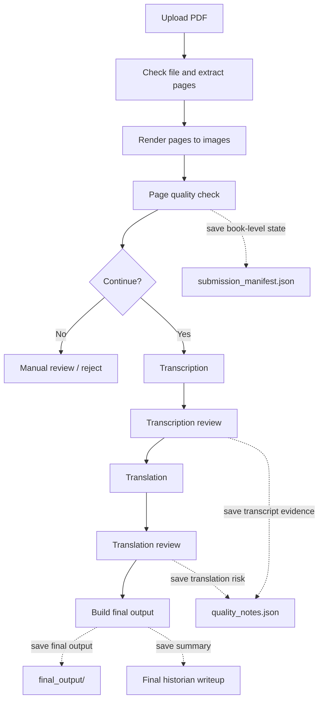

# Yizkor Pipeline Overview

This is the high-level plan for the Yizkor pipeline. It keeps the project readable, easy to debug, and flexible as it grows.

## 1. Pipeline summary

The pipeline has four main jobs:

1. Collect and check the submitted Yizkor book
2. Transcribe the text with an LLM
3. Translate the transcribed text with an LLM
4. Put the final result into a usable format for historians

## 2. High-level flow

## 3. Shared data and file model

The project keeps a few shared files that move through the pipeline as a submission is processed.

- The "submission manifest" tracks the whole book: source file, page list, and status.
- "Page records" track quality checks, page status, and any issues found on that page.
- Quality notes stay separate from the main output.
- JSON is used to store state between stages so the workflow is easier to inspect later.

The system does not rely on hidden state. Each stage reads the current submission state, adds evidence, and writes updated records for the next stage to use.

## 4. Core documents

Use these as the main design references for the project:

- [pipeline-spec.md](pipeline-spec.md) — the full stage-by-stage plan for the pipeline
- [quality-evaluation-spec.md](quality-evaluation-spec.md) — the page-quality model, severity levels, and evaluation structure

These are the main documents to check before changing the architecture or implementation.

## 5. Design principles

- Keep the pipeline simple and page-based before adding more complexity.
- Treat quality as evidence, not as a prompt override.
- Keep quality notes separate from the final output so the text stays clean and reviewable.
- Save submission state, page quality, and evaluation evidence in JSON so the workflow can be inspected later.
- Keep human review focused on meaningful risk and the final historian-facing summary.
- Build the system around traceable state changes so every stage is easier to debug.
- Design for pause/resume: save progress after each major stage so a long-running LLM workflow can pick up later without restarting from scratch.

## 6. Intended workflow

This project is meant to work like a series of saved checkpoints, not one giant run.

- Each stage reads the current submission state.
- Each stage writes new evidence and output to disk.
- Once a stage is done, its status is saved so the next stage can start from a known point.
- If the process is interrupted, it should be able to pick up where it left off instead of restarting everything.

This matters because the LLM steps can take a long time and may fail partway through. Saving progress makes the pipeline easier to debug, easier to resume, and safer to run in long batches.

For the full stage-by-stage plan, see [pipeline-spec.md](pipeline-spec.md).
