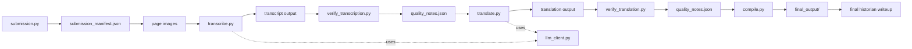

# Pipeline Specification

## 1. Scope

This project takes a Yizkor book submission and processes it through a few clear stages:

1. validate and evaluate the source PDF at the page level
2. transcribe usable pages with an LLM
3. verify the transcription result
4. translate the accepted transcript with an LLM
5. verify the translation result
6. assemble the final output for historians

The system is designed to be easy to understand, easy to pause and resume, and easy to debug. It uses one submission-level record and page-level quality evidence.

---

## 2. Core operating model

The pipeline is built around three rules:

1. the submission has a single top-level record
2. each page gets one final workflow state
3. each page may have many issue flags, but the final state is the workflow decision

The final page states are:

- accepted
- needs_review
- rejected
- skipped

These states are operational. They tell the system what to do next.

Quality issues are separate from the page state. A page can be marked with a warning, a risk flag, or a source-quality problem without necessarily being rejected. The state is the decision; the flags are the evidence.

A skipped page is still part of the submission record. It is not silently removed, renumbered, or treated as missing.

---

## 3. High-level architecture



The pipeline does not just pass file names around. It passes a submission record with page metadata, stage outputs, and quality evidence that later stages can read and update.

---

## 4. Submission intake and baseline evaluation

### Purpose

Validate the source PDF, render pages to images, and create the first saved checkpoint for the run.

### Responsibilities

- accept one PDF submission
- verify file presence and basic format
- render each page to an image
- detect obvious source-quality problems such as blank pages, low contrast, blur, skew, rendering failure, or unusable layout
- record page-level flags and a final page state
- keep skipped pages in the manifest with their original page numbers
- write a checkpoint before LLM work begins

### JSON role

- submission_manifest.json stores the working submission state, page list, and page decisions
- quality_notes.json stores the reasoning behind each decision, the issue details, and the supporting evidence

### Decision rules

- reject the submission if it is unreadable, missing, or yields no usable pages
- skip a page if it is blank, clearly irrelevant, or unusable for the task, but keep it in the manifest
- set a page to needs_review if the image is readable but risky enough to warrant a second look or a retry
- set a page to accepted only if it is sufficiently usable for the next stage
- pause for review only when the problem is meaningful enough to affect the stage outcome

### Output

- page images
- submission_manifest.json
- quality_notes.json

---

## 5. Page-level decision model

The project uses one state per page and many possible issue flags.

### State definitions

- accepted: continue to the next stage
- needs_review: continue, but flag for closer inspection or a retry
- rejected: do not continue automatically until the issue is addressed
- skipped: intentionally excluded, but still visible in the record

### Review gate policy

Review happens after each stage where output quality matters.

- after submission: decide whether the page is usable at all
- after transcription: decide whether the transcript is trustworthy enough to continue
- after translation: decide whether the translation is trustworthy enough to finalize

The important rule is that a low-confidence page does not have to be rejected immediately. It can be retried, flagged for review, or excluded, depending on the stage and the risk level.

### Flags and evidence

A page can carry several issue records, for example:

- low_contrast
- blur
- skew
- blank_page
- repeated_text
- unclear_structure
- uncertain_translation

Each issue record should include:

- category
- severity
- confidence
- evidence
- action
- source_stage
- note

The page state is the final decision. The flag list is the supporting evidence.

---

## 6. Stage 2: Transcription

### Purpose

Transcribe the pages that are still active for processing. Skipped pages remain in the record but are not sent to the model.

### Responsibilities

- read the active page list from the manifest
- process active pages in original page order
- pass page metadata and known quality issues as structured context
- use llm_client.py for model calls
- save transcript output by page or section
- keep skipped pages out of model work

### Useful inputs

- page image path
- page state
- page-level flags and notes
- readable structure signals
- page number and surrounding context

### Output

- transcript output for active pages
- per-page confidence or uncertainty notes
- page-level risk records for the verification stage

### Review behavior

The transcription stage should not just say pass or fail. It should record where the model likely struggled, where structure is unusual, where output is missing, and where the source may have been too weak.

This creates the evidence needed for the next review gate.

---

## 7. Stage 3: Transcription verification

### Purpose

Check whether the transcription output is accurate enough to continue.

### Responsibilities

- read transcript output for active pages
- compare the page and its image to the model result
- identify missing text, repeated content, odd formatting, suspicious OCR artifacts, or unclear structure
- update the page states in the manifest
- write additional findings to quality_notes.json
- decide whether a page should continue, be retried, or be sent for review

### Operational logic

- accepted: continue to translation
- needs_review: pause and inspect, or retry before continuing
- rejected: do not continue with this page without correction
- skipped: intentionally excluded and still preserved in the record

### Review gate

A page should not be forced through a later stage just because it is slightly noisy. Human review should happen when the uncertainty is large enough to affect trust in the output. This happens after transcription, and it can also happen after translation.

---

## 8. Stage 4: Translation

### Purpose

Translate the accepted transcript into a cleaner final form while preserving ambiguity where the source is uncertain.

### Responsibilities

- read transcript output and page status
- carry forward known quality findings and risk notes
- avoid smoothing over pages that are weak or unclear
- use llm_client.py for model requests
- record uncertainty and possible mistranslation risk in the output metadata

### Output

- translated text for active pages
- translation confidence notes
- issues that should be reviewed before finalization

---

## 9. Stage 5: Translation verification

### Purpose

Check whether the translation is faithful and dependable enough to move forward.

### Responsibilities

- compare translated text to the transcript and source page context
- flag suspicious wording, ambiguous names, missing details, or likely mistranslation
- update page statuses in the manifest
- record evidence in quality_notes.json
- decide whether the page should continue, be retried, or be sent for review

### Operational logic

Use the same simple state model as transcription verification:

- accepted
- needs_review
- rejected
- skipped

### Human review policy

Human review should happen at the end of each stage when low-confidence or risky output is present. The user should be able to decide whether to continue with caution, retry the stage, or remove a page from the workflow.

---

## 10. Stage 6: Compile and output

### Purpose

Assemble the final product from the accepted pages and keep the quality record separate from the final output.

### Responsibilities

- gather transcript and translation outputs for active pages
- include page-level quality notes in the summary when relevant
- preserve page continuity throughout the final assembly
- keep the quality notes sidecar separate from the final formatted output

### Output structure

```text
final_output/
  submission_summary.json
  transcript.txt
  translation.txt
  formatted_output.txt
  quality_notes.json
```

The quality notes file stays separate from the final writeup so a human can inspect it without mixing evidence with the narrative output.

---

## 11. Shared artifacts

### submission_manifest.json

This is the operational record. It tracks:

- submission metadata
- page list and page numbers
- page-level state
- skip reasons
- overall status of the run

### quality_notes.json

This is the evidence layer. It tracks:

- issue categories
- severity and confidence
- supporting evidence
- recommended action
- notes for humans

### llm_client.py

This is the provider wrapper for the LLM. It is not the orchestration layer and it does not decide the workflow state on its own.

---

## 12. Final workflow rule

The project should make decisions in this order:

1. determine page quality from the source
2. decide whether the page is usable
3. process the page if it is active
4. verify output at the current stage
5. either continue, retry, ask for review, or skip
6. preserve the page in the manifest even if it is excluded

This keeps the process understandable, resumable, and consistent from stage to stage.

   - centralizes request, retry, and parsing code

### Important rule

Each stage should only write the fields it owns. It should not overwrite earlier evidence unless it is specifically updating a result field.

---

## 10. Quality and review rules

### Evaluation philosophy

The evaluation system is deliberately not prompt-editing. It is metadata-driven.

This means:

- quality data is stored in JSON
- quality notes stay with the work but do not change the source text
- the model gets structured quality signals only when needed
- later stages can inspect and compare quality results over time

This keeps the system easy to explain and helps avoid prompt contamination.

### Page-level design decision

This pipeline uses page-level records because they are simple and easy to maintain.

Benefits:

- easier to understand and debug
- easy to map to page images
- works well with a PDF-to-page workflow
- keeps early implementation simple

Trade-offs:

- less detailed than segment-level records
- less precise for paragraph-level uncertainty
- later stages may want more detail for fine-grained section tracking

This is an intentional trade-off to keep the system readable while it is still young.

### Human review philosophy

Human review should stay minimal and be reserved for meaningful risk.

The final writeup should highlight:

- where the source was difficult
- which pages may contain mistakes
- what the historian should double-check
- which parts were generated with lower confidence

The goal is not to add a lot of manual intervention points. The goal is to produce a strong final summary that helps a historian judge how much trust to place in the result.

---

## 11. Operational behavior

The system should work like a series of saved checkpoints, not one giant run.

- each stage reads the current submission state
- each stage writes its results to disk before the next stage begins
- a long-running LLM step should be resumable if the process is interrupted
- partial progress should be inspectable and recoverable

This matters because the transcription and translation steps may take a long time and can fail partway through. Saving progress makes the project easier to debug and easier to continue later without restarting from scratch.

---

## 12. Lifecycle checklist

At a high level, the project lifecycle should follow this pattern:

- validate the source PDF
- extract page images
- evaluate page quality
- decide whether to continue
- transcribe the text
- verify the transcription
- translate the text
- verify the translation
- assemble the final output
- produce a final historian-facing summary
- store separate quality notes for optional review

This creates a full and debuggable loop that stays understandable even as the project grows.
